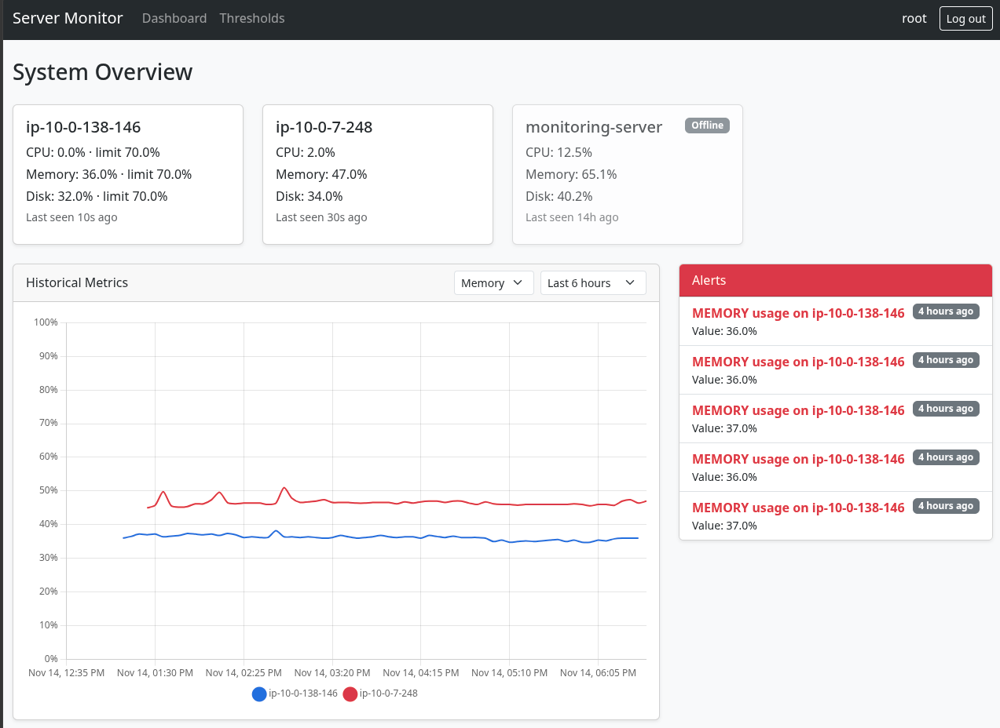
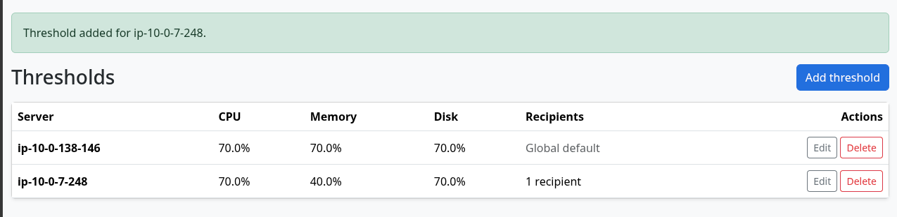
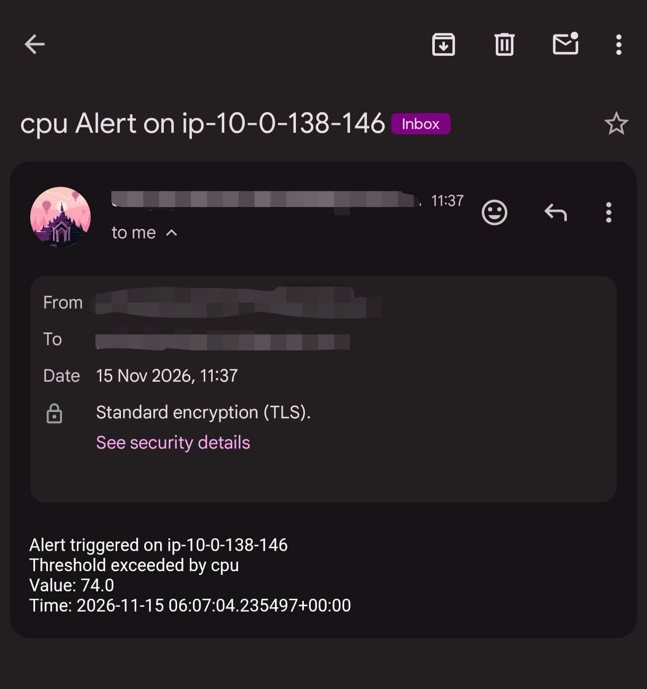
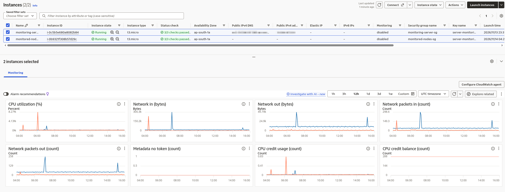
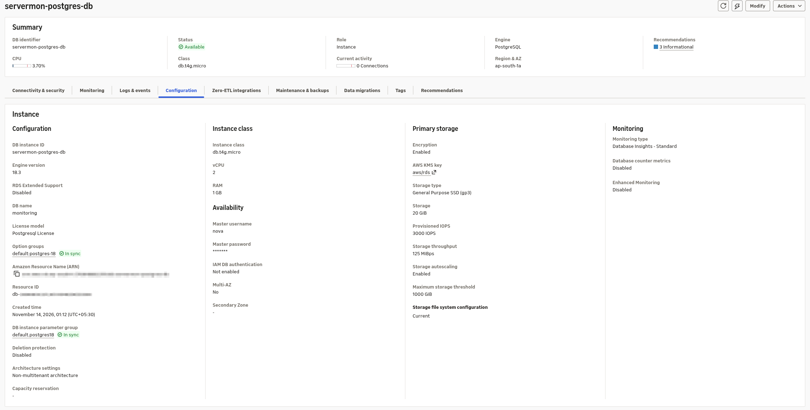
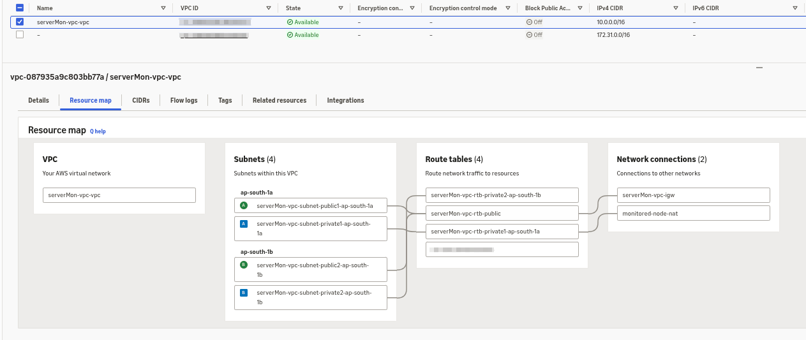

# server-monitor

Cloud-Native Server Monitoring API with Per-Instance Alerting and Push Model

## How It Works

### Architecture Overview

```
┌──────────────────────────────────────────────────────────────┐
│                     MONITORED SERVERS                        │
│                                                              │
│  setup.sh (infinite loop, every 15s)                         │
│    └── metrics_push.py                                       │
│          ├── scripts/cpu.sh    ── reads /proc/stat           │
│          ├── scripts/memory.sh ── reads /proc/meminfo        │
│          └── scripts/disk.sh   ── reads df --total           │
│                                                              │
│          POST /api/v1/metrics/push/  (Token auth)            │
└─────────────────────────────┬────────────────────────────────┘
                              │
                              ▼
┌──────────────────────────────────────────────────────────────┐
│                    DJANGO API SERVER                         │
│                                                              │
│  POST /api/v1/metrics/push/    - stores Record               │
│                                   checks Thresholds          │
│                                   fires Alert + email        │
│                                                              │
│  GET  /api/v1/metrics/latest/  - latest per server           │
│  GET  /api/v1/metrics/timeseries/ - history for all servers  │
│  GET  /api/v1/alerts/active/   - last 10 alerts              │
│                                                              │
│  ┌─────────────────────┐     ┌──────────────────────────┐    │
│  │     PostgreSQL      │     │      Gmail SMTP          │    │
│  │  (Records, Alerts,  │     │  (Threshold alerts via   │    │
│  │   Thresholds)       │     │   email)                 │    │
│  └─────────────────────┘     └──────────────────────────┘    │
│                                                              │
│  DASHBOARD (auto-refreshing)                                 │
│    ├── Status cards     ── polls every 10s                   │
│    ├── All-server chart ── refreshes every 5min              │
│    └── Alert feed       ── polls every 20s                   │
└──────────────────────────────────────────────────────────────┘
```

### Data Flow

1. **Collect** — Each monitored server runs `setup.sh`, which loops every 15 seconds. Each iteration calls `metrics_push.py`, which runs three Bash scripts that read system metrics directly from `/proc/stat`, `/proc/meminfo`, and `df`.

2. **Push** — `metrics_push.py` assembles the metrics into a JSON payload (tagged with `hostname` as `instance_name`) and POSTs it to the central Django API, authenticated with a token.

3. **Store & Alert** — The API stores the metrics in PostgreSQL. If a `Threshold` exists for that server instance, the API checks CPU/memory/disk against the configured limits. If exceeded, an `Alert` record is created and an email is sent (with a 2-minute cooldown per metric type to prevent flooding).

4. **Visualize** — The dashboard at `/dashboard/` auto-refreshes:
   - Status cards show live metrics, thresholds, and offline state (polls `/api/v1/metrics/latest/` every 10s)
   - The chart compares all servers as separate lines, with CPU/memory/disk and 6h–7d ranges (refreshes every 5min)
   - Alert feed shows the 10 most recent alerts (polls every 20s)

### Tech Stack

| Layer              | Technology                       |
| ------------------ | -------------------------------- |
| Backend            | Django 5.2, Django REST Framework|
| Database           | PostgreSQL                       |
| Frontend           | Bootstrap 5.3, Chart.js 4.4      |
| Auth               | DRF Token + Django session auth  |
| Metrics Collection | Bash scripts + Python pusher     |
| Email Alerts       | Django SMTP (Gmail)              |

### Project Structure

```
server-monitor/
├── metrics_push.py            # Collects metrics, POSTs to API with auth token
├── setup.sh                   # Infinite loop that runs metrics_push.py
├── scripts/
│   ├── cpu.sh                 # Reads CPU usage from /proc/stat
│   ├── disk.sh                # Reads disk usage from df
│   └── memory.sh              # Reads memory usage from /proc/meminfo
├── requirements.txt
├── .env.example               # Template for required environment variables
└── server-monitoring/         # Django project
    ├── manage.py
    ├── monitoring/            # Project config (settings, urls, wsgi)
    │   └── settings.py        # DB, email, REST_FRAMEWORK, security config
    └── monitor_app/           # Main application
        ├── models.py          # Record, Alert, Threshold
        ├── views.py           # API endpoints, dashboard, threshold pages
        ├── forms.py           # Threshold add/edit form
        ├── serializers.py     # DRF serializers
        ├── admin.py           # Admin panel configuration
        ├── tests.py           # API and model tests
        ├── migrations/        # Database migrations
        ├── static/
        │   └── monitor_app/
        │       └── dashboard.js
        └── templates/
            ├── base.html
            ├── registration/login.html
            └── monitor_app/
                ├── dashboard.html
                ├── threshold_list.html
                ├── threshold_form.html
                └── threshold_confirm_delete.html
```

### Key Concepts

- **Push Model** — Each server pushes its own metrics (vs. a central server pulling/scraping). This is more scalable and works across firewalls.
- **Per-Instance Thresholds** — Each server can have its own CPU/memory/disk limits, configured at `/thresholds/` or in the Django admin.
- **Alert Deduplication** — The same metric type on the same server won't re-alert within 2 minutes.
- **Token Authentication** — Only servers with a valid API token can push metrics. Dashboard pages and read APIs require a logged-in session; threshold management is staff-only.

## Local Setup

1. Clone Repository
```
git clone https://github.com/NightShadeNova/server-monitor.git
cd server-monitor
```

2. Create and activate virtual environment
```
python3 -m venv server-monitoring/venv
source server-monitoring/venv/bin/activate
```

3. Install Dependencies
```
pip install -r requirements.txt
```

## PostgreSQL Config

1. Create database
```sql
CREATE DATABASE monitoring;
CREATE USER nova WITH PASSWORD 'change-me';
GRANT ALL PRIVILEGES ON DATABASE monitoring TO nova;
GRANT ALL PRIVILEGES ON SCHEMA public TO nova;
```

2. Set environment variables (or copy `.env.example` to `.env` and fill in values)
```
export DB_NAME='monitoring'
export DB_USER='nova'
export DB_PASSWORD='change-me'

export DJANGO_SECRET_KEY='<YOUR_RANDOM_SECRET_KEY>'
export EMAIL_HOST_USER='your.monitoring.sender@gmail.com'
export EMAIL_PASSWORD='YOUR_GENERATED_APP_PASSWORD'
export ALERT_RECIPIENT_EMAIL='your.personal.inbox@example.com'
```

3. Run migrations
```
python server-monitoring/manage.py migrate
python server-monitoring/manage.py createsuperuser
```

4. Create API token for metrics push authentication
```
python server-monitoring/manage.py drf_create_token <your-username>
```
This prints a token like `9944b09199c62bcf9418ad846dd0e4bbdfc6ee4b`. Add it to your env:
```
export METRICS_API_TOKEN='your-token-here'
```

5. Configure
Start server - `python server-monitoring/manage.py runserver`
Log in - http://127.0.0.1:8000/accounts/login/
Dashboard - http://127.0.0.1:8000/dashboard/
Thresholds - http://127.0.0.1:8000/thresholds/ (staff users only)
Set the server instance to match the hostname returned by `socket.gethostname()` on your monitored machine.

The Django admin remains available at http://127.0.0.1:8000/admin/ for user management.

## Final Starting

1. Run the metrics pusher loop (update your project path first in `setup.sh`)
```
nohup ./setup.sh &
```

## AWS Deployment

The application is deployed on AWS using two EC2 instances and an Amazon RDS PostgreSQL database. The deployment separates the monitoring application from the machines being monitored.

### Deployment Architecture

The deployment consists of three main components:

- **Monitoring Server (EC2):** Hosts the Django application, Gunicorn application server and Nginx reverse proxy. It exposes the metrics ingestion API and serves the monitoring dashboard.
- **Monitored Instance (EC2):** Runs a lightweight metrics collector that periodically gathers CPU, memory and disk usage and pushes the collected metrics to the monitoring server.
- **Database (Amazon RDS):** Hosts the PostgreSQL database used to persist metric records and application data.

The monitored instance runs in a private subnet and communicates with the monitoring server over the VPC's private network.

### Architecture Flow

```text
                  Internet
                     |
                     | HTTP :80
                     v
          +-----------------------+
          |   Monitoring EC2      |
          |   Public Subnet       |
          |                       |
          |       Nginx           |
          |         |             |
          |         | Proxy       |
          |         v             |
          |      Gunicorn         |
          |         |             |
          |         v             |
          |    Django + DRF       |
          |         |             |
          +---------|-------------+
                    |
                    | PostgreSQL :5432
                    v
          +-----------------------+
          |    Amazon RDS         |
          |    PostgreSQL         |
          +-----------------------+

          +-----------------------+
          |    Monitored EC2      |
          |    Private Subnet     |
          |                       |
          |   Metrics Collector   |
          |          |            |
          |   CPU / Memory / Disk |
          +----------|------------+
                     |
                     | HTTP :80
                     | Private IP
                     v
              Monitoring EC2
              /api/v1/metrics/push/
```

### Infrastructure Overview

| Component | Configuration |
|---|---|
| Cloud Provider | AWS |
| Region | ap-south-1 |
| Monitoring Server | EC2 (Ubuntu 24.04, t3.micro) |
| Monitored Instance | EC2 (Ubuntu 24.04, t3.micro) |
| Database | Amazon RDS PostgreSQL |
| Application Server | Gunicorn |
| Reverse Proxy | Nginx |
| Process Management | systemd |

### Metrics Collection and Data Flow

1. The metrics collector executes periodically on the monitored EC2 instance.
2. Shell scripts collect CPU, memory and disk usage.
3. The collector sends the metrics to the monitoring server through the Django REST API, using token authentication.
4. Django validates and processes the incoming metrics.
5. The metrics are stored in the PostgreSQL database hosted on Amazon RDS.
6. The dashboard retrieves the latest and historical metrics and displays them using Chart.js.
7. Threshold-based alerting evaluates incoming metrics and generates alerts when configured limits are exceeded.

### Application Deployment

The Django application runs behind Gunicorn, with Nginx acting as the reverse proxy.

- **Nginx** listens for incoming HTTP requests on port 80 and forwards application requests to Gunicorn. It also serves collected static files.
- **Gunicorn** runs the Django WSGI application on `127.0.0.1:8000`.
- **systemd** manages the Gunicorn process, ensuring that the application starts on boot and can be restarted independently.
- **Static files** are collected using Django's `collectstatic` command and served by Nginx from `/var/www/server-monitoring/static/`.

The metrics collector is also managed by systemd on the monitored EC2 instance. It runs independently of the Django application and automatically restarts if the process exits.

### Network and Security Configuration

The deployment uses AWS security groups to restrict communication between components.

- SSH access to the monitoring server is restricted to the administrator's public IP.
- The monitored instance accepts SSH access through the monitoring server, which acts as a bastion host.
- The monitoring server accepts application traffic through HTTP on port 80.
- The RDS instance accepts PostgreSQL connections only from the monitoring server's security group.
- The monitored instance communicates with the monitoring server through its private IP address.

### HTTP Configuration

The current deployment uses **HTTP only**.

- Nginx listens on port 80.The monitored instance sends metrics to the monitoring server using its private IP over HTTP.
- Gunicorn is bound to `127.0.0.1:8000` and is not directly exposed to the internet.
- Django's SSL redirect and secure session/CSRF cookie settings are disabled for the current HTTP deployment (SECURE_SSL_REDIRECT=False, SESSION_COOKIE_SECURE=False, CSRF_COOKIE_SECURE=False).

### Deployment Configurations

The following configuration examples are used to document
the AWS deployment:

| Configuration | Description |
|---|---|
| [Nginx](docs/config/nginx.conf) | Reverse proxy and static file serving |
| [Gunicorn](docs/config/gunicorn.service) | Django application server |
| [Metrics Collector](docs/config/metrics-collect.service) | systemd service for metrics collection |

### Dashboard



### Alert Threshold



### Alert Mail



### EC2 Instances



### RDS PostgreSQL



### VPC Route


